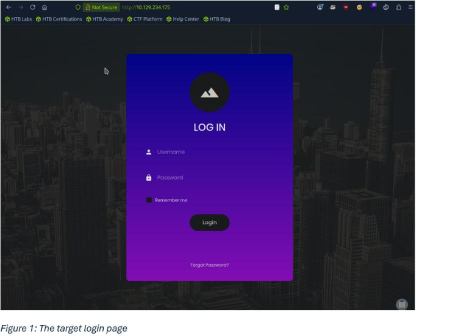
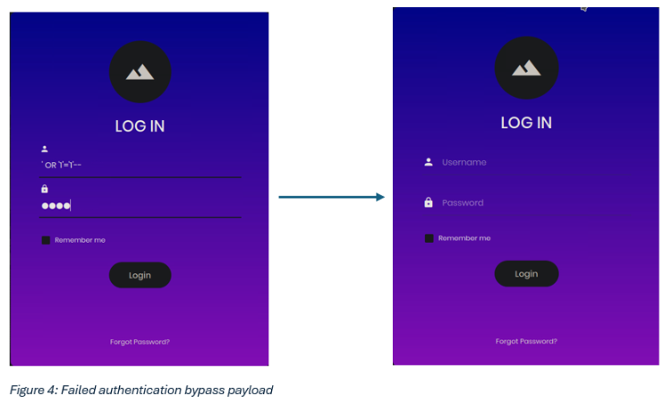
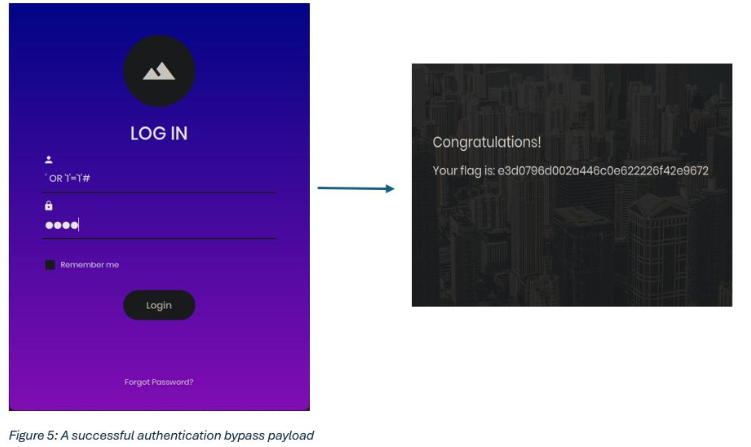
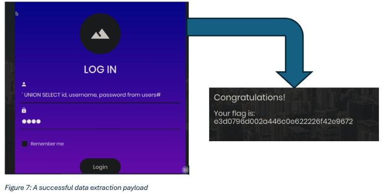

# SQL Injection | Blue team and Red Team Security Analysis
This project investigates SQL Injection (SQLi) vulnerabilities through practical penetration testing and defensive security analysis using the Hack The Box 'Appointment' machine.
## Team Members

Ali Fares | RED TEAM | https://www.linkedin.com/in/ali-fares-86870733a/

Joshua Kwon | BLUE TEAM | https://www.linkedin.com/in/joshua-kwon-05914337a/

## 0. Executive Summary

This report delves into the concept of SQL injection (SQLi) vulnerabilities and how
unvalidated user input is exploited to generate malicious SQL requests using a backend
database on a web application service such as a webpage. The ‘Appointment’ machine
contained a login webpage service which had limited defences against SQLi and as a
result, Authentication Bypass, UNION-based and automated blind SQLi were practically
demonstrated to bypass authentication and extract sensitive user data entirely by
manipulating SQL logic. These findings effectively outlined the vulnerability of the
machine due to its severe lack of input validation and sanitation. The proposed
defensive techniques to harden the ‘Appointment’ were parameterised queries, input
validation and sanitation and a Web Application Firewall (WAF). These defences would
significantly mitigate the machine’s vulnerability to SQLi as malicious requests would
be blocked and repeated suspicious automated requests would be blocked by the WAF.
Ultimately, this report demonstrates how SQLi must be considered as a critical risk to
web applications and must have layered defences and protocols implemented to
secure systems.

## 1. Introduction

Injection vulnerabilities are potential points of entry that attackers can use to inject
malicious code or statements through web applications such as a website with a login
page. (Owasp, n.d.) These vulnerabilities occur when untrusted user input is not
properly validated before being processed by an application. As a result, attackers can
manipulate databases, execute unauthorised commands, or gain access to sensitive
client data. (SentinelOne, 2024). Injection attacks remain one of the most critical
cybersecurity risks because of their ability to compromise the confidentiality, integrity,
and availability of systems and data. According to the Open Web Application Security
Project (OWASP), injection vulnerabilities continue to rank among the most dangerous
web application security risks due to their widespread presence and severe
consequences (OWASP, n.d.).

One of the most common forms of an injection attack is Structured Query Language
(SQL) injection. SQL injection, which can be abbreviated to “SQLi” involves injecting
malicious SQL code into input fields in an application layer service which connects to
any database which uses SQL. (Cloudflare, n.d.). SQLi abuses SQL logic to return or
retrieve data from the database that it shouldn’t. It usually begins with input
enumeration to identify what ways an input is vulnerable. This could be tested in the
URL, form entry, or field entry. Once a vulnerability is found, a malicious SQL payload is
formed with SQL language. The attack is then executed, and data is manipulated to the
desire of the attacker. Depending on the results, data extracted may be used for further
malicious purposes. (Hofesh, 2022)

Defence against injection attacks should have a proactive approach where systems
should be actively preventing injection attacks from ever successfully executing by
having pre-built defences against specific vulnerabilities. Defence against general
injection attacks involve validating user input to prevent any malicious request from
successfully executing on a server and/or database. (SentinelOne, 2024).
A common defence against SQLi attacks is the use of parameterised queries, also
known as prepared statements. Parameterised queries separate user input from SQL
commands, ensuring that any data entered by a user is treated only as plain text rather
than executable SQL code. This prevents attackers from injecting malicious SQL
statements into database queries. For example, when a user enters a username and
password into a login form, the application sends the input to the database using
predefined query structures rather than directly inserting the input into the SQL
command. Even if an attacker attempts to enter malicious SQL code such as ' OR '1'='1,
the database interprets the input as a normal string instead of executable code,
preventing unauthorised access (OWASP, n.d.).

## 2. Attacking
### 2.1 HTB Machine ‘Appointment’ - Enumeration

The default page the target leads to. Note that errors are hidden from the user as the site
reloads when invalid credentials are put in.

Reveals that login requires both fields to be filled to submit a payload.

If the user input is handled without any validation the attacker can manipulate this
select query to make malicious payloads.

### 2.2 In-Band SQLi

#### 2.2.1 Authentication Bypass SQLi

Authentication bypass attacks attempt to bypass login verification by manipulating the
SQL query to have an always true value while commenting out the password check
entirely. This is done completely using the username field. (scriptpy, 2026)

The payload was crafted with the idea that the select statement is similar or identical to
Figure 3. It is essential to identify which type of database is being used by the login such
as Oracle, MySQL, etc. This can highlight what type of payloads the attacker must make
to successfully interact with the database. (Questions, 2025). This payload fails as the
webpage may not accept the dashes to comment out sql code. This demonstrates that the webpage might be using MySQL as it also uses ‘#’ to comment. (MySQL :: MySQL 9.7 Reference Manual :: 11.7 Comments, 2026).

The payload works as the first commas closes the first part of the string and begins a
new condition with ‘OR’ the ‘1’ = ‘1’ sets the condition to always true and the ‘#’
comments out the password completely. The attacker successfully bypasses login and
is granted access.

#### 2.2.2 Union-based SQLi

Union based SQLi involves attackers using the UNION operation keyword to combine
multiple select statements into the original select statement. Union based SQLi can
test how many columns are in a table and can reveal their contents. (PortSwigger, n.d.)

The payload sucessfully executes meaning that the database the site uses has 3
columns of data. While no column data was extracted, this discovery can lead to
another payload to guess the column names from the table to extract the data contents.
The ‘Appointment’ machine is limited to show the flag or a failed login screen when a
payload is executed.

The payload passes with specific column names and a user table. These were
essentially estimated by the attacker as a user credential table would very likely have an
identifier (primary key), username and password. This payload would effectively show
all data in all those listed columns however due to the limited nature of the machine
environment it only lists the flag page.

### 2.3 Automated Blind SQLi (SQLMAP)
## 3. Defending 
### 3.1 Parameterised Queries / Prepared Statements
### 3.2 Input Validation and Sanitisation
### 3.3 Web Application Firewalls and Error Handling
## 4. Discussion
## 5. Lessons Learned
## 6. References
